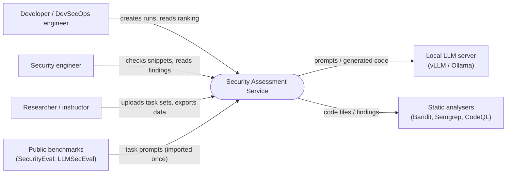
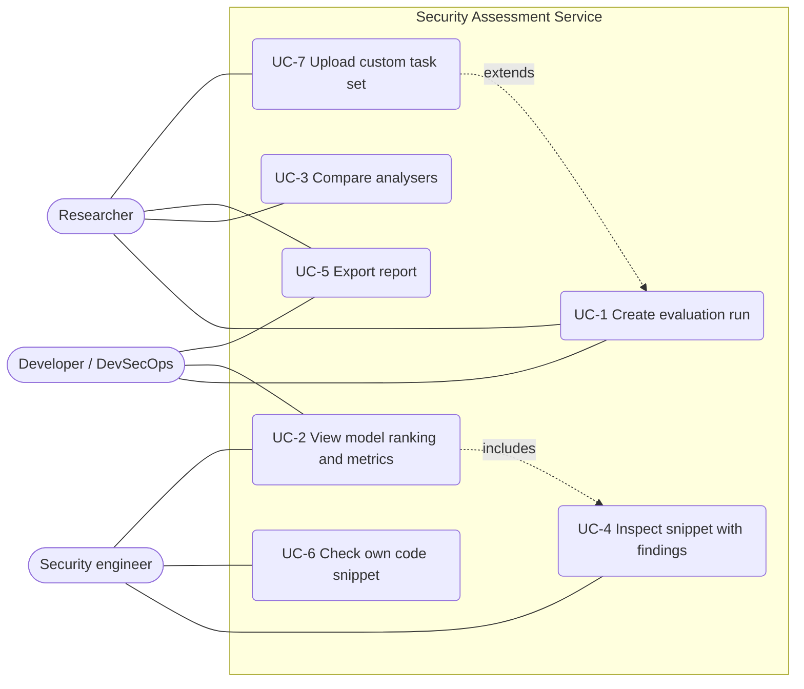
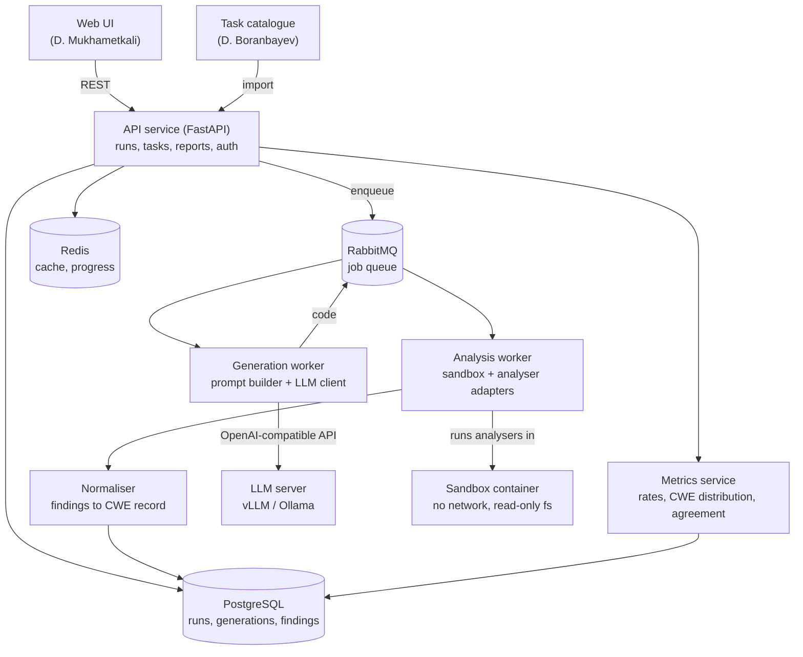

# 7. Architecture and Diagrams

Author: Andrey Rudov. Status: draft v0.1 (component diagram is a draft), 2026-10-20.

Diagram sources are Mermaid files in [diagrams/](diagrams/); GitHub renders them below.
Edit the `.mmd` files and paste the changes here.

## 1. System context

Who and what the service talks to. Source: [diagrams/system-context.mmd](diagrams/system-context.mmd).

## 2. Use cases

Source: [diagrams/use-cases.mmd](diagrams/use-cases.mmd). Mermaid has no UML use-case notation, so actors are rounded
nodes and use cases are ovals inside the system boundary; dotted arrows are include/extend.

| UC | Main scenario |
|---|---|
| UC-1 | User selects models, task set and conditions; the service queues the run, generates code, scans it, stores findings. |
| UC-2 | User opens a finished run and reads the per-model share of insecure outputs and the CWE distribution. |
| UC-3 | User opens the analyser agreement table for a run. |
| UC-4 | User opens one generation and sees the code with highlighted findings. |
| UC-5 | User downloads the run as JSON or CSV. |
| UC-6 | User pastes a snippet and gets normalised findings without any LLM call. |
| UC-7 | User uploads a JSONL task set; it is validated and becomes selectable in UC-1. |

## 3. Components (draft)

Source: [diagrams/components.mmd](diagrams/components.mmd).

### Component responsibilities

| Component | Responsibility | Requirements |
|---|---|---|
| API service | REST API, validation, run lifecycle, auth, serves report data | FR-01, FR-02, FR-03, FR-13, FR-15, FR-16 |
| Generation worker | Builds the prompt for a condition, calls the LLM, extracts code from the response | FR-04, FR-05, FR-06 |
| Analysis worker | Starts the sandbox, runs the analyser adapters, collects raw output | FR-07, NFR-02 |
| Normaliser | Maps each analyser's output to the common finding record and CWE | FR-08 |
| Metrics service | Computes rates, distributions, ranking and agreement from stored findings | FR-09, FR-10, FR-11 |
| PostgreSQL / Redis | Durable results; cache and progress counters | NFR-03, NFR-06 |
| Web UI | Run creation, progress, ranking, snippet view, export | FR-11, FR-12, FR-13 |

### Main data flow

1. UI calls `POST /runs`; the API stores the run and publishes one generation job per (model, task, condition).
2. A generation worker builds the prompt, calls the LLM server, stores the raw response and the extracted code, and publishes an analysis job.
3. An analysis worker runs the three analysers in a sandbox container, the normaliser stores findings.
4. For the repair condition, findings are returned to a generation job (maximum 3 rounds).
5. When all jobs of a run finish, the run status becomes `done`; metrics are computed on request from stored findings.

## 4. Data model (summary)

`run` 1-N `generation` (model, task, condition, iteration, raw_response, code) 1-N `finding`
(analyser, rule_id, cwe, severity, line, raw JSON). `task` carries source, CWE and prompt text.

## 5. Decisions and traceability

Technology choices are justified in [technology-comparison.md](technology-comparison.md); every
component above maps to requirements in [requirements.md](requirements.md). The component
diagram is a draft: the split between generation and analysis workers may be merged if the spike shows no benefit.
