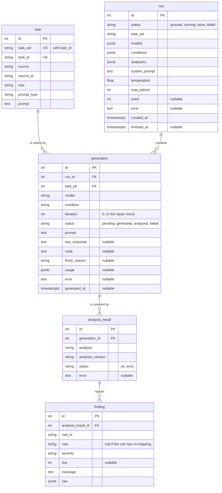

# Database Schema

PostgreSQL schema of the service (DIP-14). The source of truth is
[backend/app/models.py](../backend/app/models.py); changes go through Alembic migrations in
`backend/migrations/`, applied by the `migrate` service on `docker compose up`.

## Rules

- `generation` is also the unit of work: one row per (run, task, model, condition, iteration).
- `analysis_result` has one row per analyser and generation, **including analysers that found
  nothing** (FR-07). A failed scan has status `error` and must not be counted as clean.
- The analyser of a finding is the one of its `analysis_result` (FR-08).
- Reproducibility fields (NFR-06): model id (`generation.model`), parameters and seed (`run`),
  prompt text (`run.system_prompt`, `generation.prompt`), analyser version (`analysis_result`).
