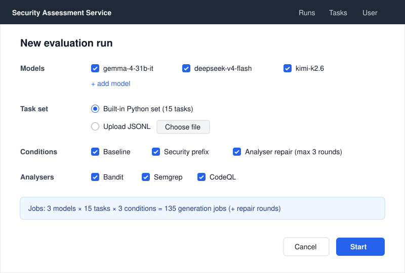
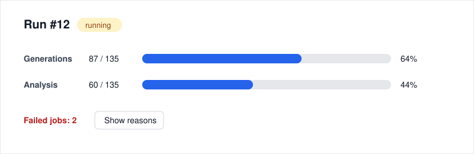
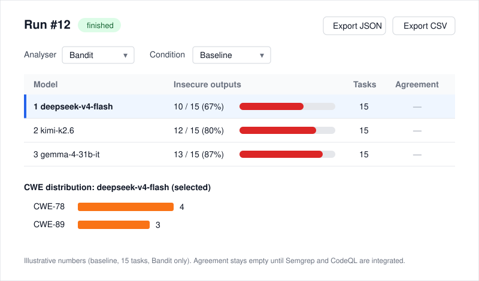
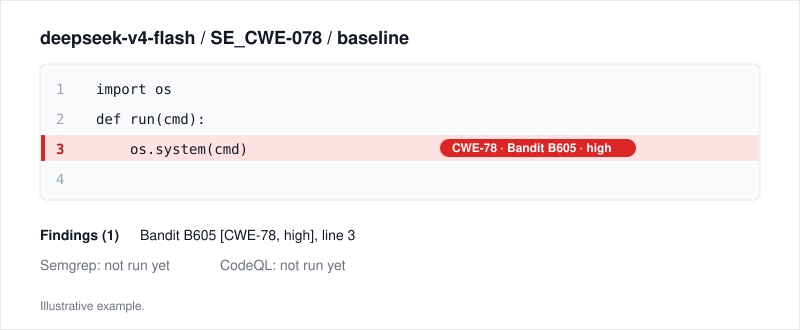

# 8. UX / Prototype

Author: Dias Mukhametkali. Status: draft v0.2 (low-fidelity mockups), 2026-10-23.

Mockups of screens S1-S4 are SVG images in [img/](img/), drawn from the text wireframes below.
Figma version: TODO (to follow after pre-defense 1).
The API examples are the contract between the UI and the backend ([requirements.md](requirements.md)).

All screens and examples use one scenario: 3 models (gemma-4-31b-it, deepseek-v4-flash, kimi-k2.6) x 15 tasks
x 3 conditions = 135 generation jobs before repair rounds. The `analyser_repair` condition can add up to 3 repair
jobs per task with findings (FR-06), so the final job count can be higher.

All numbers on the screens and in the API examples are **illustrative**: they show the layout and the data shape,
not measured results.

## 1. Key user scenarios

| Scenario | Use case | Steps |
|---|---|---|
| A. Compare models | UC-1, UC-2 | New run, choose models and conditions, watch progress, open ranking |
| B. Understand a finding | UC-4 | From the ranking open a model, open a snippet, see the highlighted finding with CWE |
| C. Export | UC-5 | Download JSON/CSV from the run page |
| D. Check own snippet | UC-6 | Paste code, get findings |
| E. Compare analysers | UC-3 | On the ranking screen read the Agreement column for the run |
| F. Upload custom task set | UC-7 | In New run choose "Upload JSONL", the file is validated, the set becomes selectable |

## 2. Screens

### S1. New run



```
+--------------------------------------------------------------+
| Security Assessment Service             [Runs] [Tasks] [User] |
+--------------------------------------------------------------+
| New evaluation run                                           |
|                                                              |
| Models        [x] gemma-4-31b-it  [x] deepseek-v4-flash      |
|               [x] kimi-k2.6       [ ] + add model            |
|                                                              |
| Task set      (o) Built-in Python set (15 tasks)             |
|               ( ) Upload JSONL  [ Choose file ]              |
|                                                              |
| Conditions    [x] Baseline  [x] Security prefix              |
|               [x] Analyser repair (max 3 rounds)             |
|                                                              |
| Analysers     [x] Bandit [x] Semgrep [x] CodeQL              |
|                                                              |
| Jobs: 3 models x 15 tasks x 3 conditions = 135 (+ repairs)   |
|                                         [ Cancel ] [ Start ] |
+--------------------------------------------------------------+
```

### S2. Run progress



```
+--------------------------------------------------------------+
| Run #12   status: running                                    |
| Generations  87 / 135  [#############.......]  64%           |
| Analysis     60 / 135  [#########...........]  44%           |
|                                                              |
| Failed jobs: 2   [ Show reasons ]                            |
+--------------------------------------------------------------+
```

### S3. Ranking and metrics (main screen)



```
+--------------------------------------------------------------+
| Run #12   finished   [Export JSON] [Export CSV]              |
| Analyser: [ Bandit v ]   Condition: [ Baseline v ]           |
+--------------------------------------------------------------+
|   Model               Insecure outputs       Tasks  Agreement|
| > 1 deepseek-v4-flash 10 / 15 (67%) [======   ]  15       -- |
|   2 kimi-k2.6         12 / 15 (80%) [=======  ]  15       -- |
|   3 gemma-4-31b-it    13 / 15 (87%) [======== ]  15       -- |
+--------------------------------------------------------------+
| CWE distribution: deepseek-v4-flash (selected, >)            |
| CWE-78  #### 4   CWE-89 ### 3                                |
+--------------------------------------------------------------+
```

All counts are illustrative (baseline, 15 tasks, Bandit only). The CWE row counts findings with a CWE mapping and
matches `cwe_distribution` in the API example below. The Agreement column stays empty until Semgrep and CodeQL are integrated.

### S4. Snippet view



```
+--------------------------------------------------------------+
| deepseek-v4-flash / SE_CWE-078 / baseline                    |
+--------------------------------------------------------------+
|  1  import os                                                |
|  2  def run(cmd):                                            |
|  3 !    os.system(cmd)      <- CWE-78  Bandit B605           |
|  4                                                           |
+--------------------------------------------------------------+
| Findings (1): Bandit B605 [CWE-78, high]                     |
| Semgrep: not run yet   CodeQL: not run yet                   |
+--------------------------------------------------------------+
```

## 3. Frontend technology (decision)

Requirements: tables, charts, a code viewer with line highlighting, polling for progress.

| Criterion | React + Vite | Vue 3 + Vite | Server pages (Jinja + HTMX) |
|---|---|---|---|
| Charts and code viewer libraries | ++ | ++ | + |
| Separation from FastAPI backend (OpenAPI client generation) | ++ | ++ | - tied to backend |
| Learning cost for the team | + | + | ++ |
| Interactivity for progress and filters | ++ | ++ | + |

**Decision: Vue 3 + Vite.** React and Vue 3 score the same on every criterion above, so the choice follows the UI
owner's preference, and Dias, who builds the UI, chose Vue 3. To be recorded as an ADR. Scores are a judgement, not measurements.

## 4. API examples (input and output data)

Every request carries a token (FR-16); a request without one gets 401. The auth header, run progress and export
examples are **proposed, to confirm with Andrey**.

Create a run:

```http
POST /runs
Authorization: Bearer <token>
Content-Type: application/json

{
  "models": ["gemma-4-31b-it", "deepseek-v4-flash", "kimi-k2.6"],
  "task_set": "builtin-python-15",
  "conditions": ["baseline", "security_prefix", "analyser_repair"],
  "analysers": ["bandit", "semgrep", "codeql"]
}
```

```json
{ "id": 12, "status": "queued", "total_jobs": 135 }
```

`total_jobs` counts generation jobs before repair rounds (3 x 15 x 3); repair rounds can add jobs.

Run progress (FR-15, the data behind screen S2; proposed, to confirm with Andrey):

```http
GET /runs/12/progress
Authorization: Bearer <token>
```

```json
{
  "run_id": 12,
  "status": "running",
  "generations": { "done": 87, "total": 135 },
  "analysis": { "done": 60, "total": 135 },
  "failed": [ { "job_id": 41, "error": "LLM server timeout" } ]
}
```

Run summary (the data behind screen S3):

```http
GET /runs/12/summary?condition=baseline
Authorization: Bearer <token>
```

```json
{
  "run_id": 12,
  "condition": "baseline",
  "models": [
    {
      "model": "deepseek-v4-flash",
      "generations": 15,
      "with_findings": { "bandit": 10, "semgrep": null, "codeql": null },
      "cwe_distribution": { "CWE-78": 4, "CWE-89": 3 }
    }
  ],
  "agreement": [ { "pair": ["bandit", "semgrep"], "kappa": null } ]
}
```

All values are illustrative; `null` marks analysers not run yet.

Export (FR-13; proposed, to confirm with Andrey):

```http
GET /runs/12/export?format=csv
Authorization: Bearer <token>
```

Returns a CSV file with one row per generation; `format=json` returns the same data as JSON.

Check a snippet:

```http
POST /snippets/check
Authorization: Bearer <token>
Content-Type: application/json

{ "language": "python", "code": "import os\nos.system(input())" }
```

```json
{ "findings": [ { "analyser": "bandit", "rule_id": "B605", "cwe": "CWE-78", "severity": "high", "line": 2 } ] }
```

## 5. Usability checks planned

Three users run scenario A on the prototype or the first UI build; measure time and errors (NFR-07).
The prototype is also shown in the interviews ([evidence-of-relevance.md](evidence-of-relevance.md)).

## 6. Open questions for Andrey

- Can kimi-k2.6 and deepseek-v4-flash run next to gemma-4-31b-it on one machine with one GPU, as NFR-04 requires?
- Are the proposed auth header, `GET /runs/12/progress` and `GET /runs/12/export` acceptable as the API contract?
